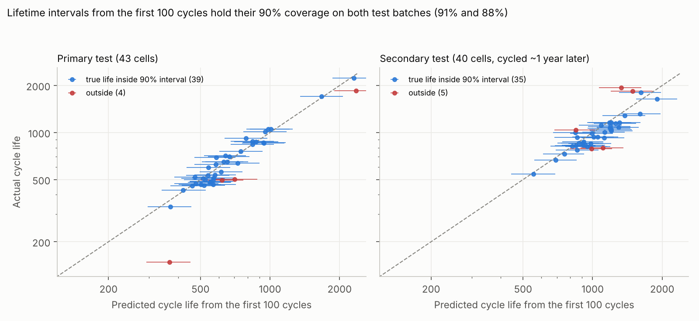
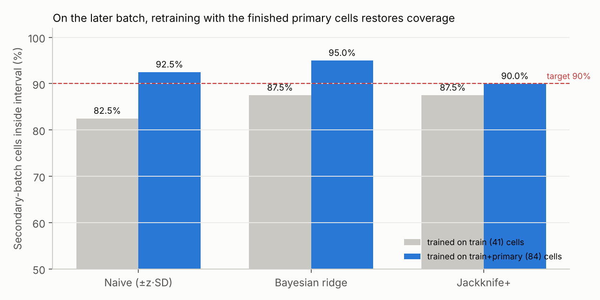
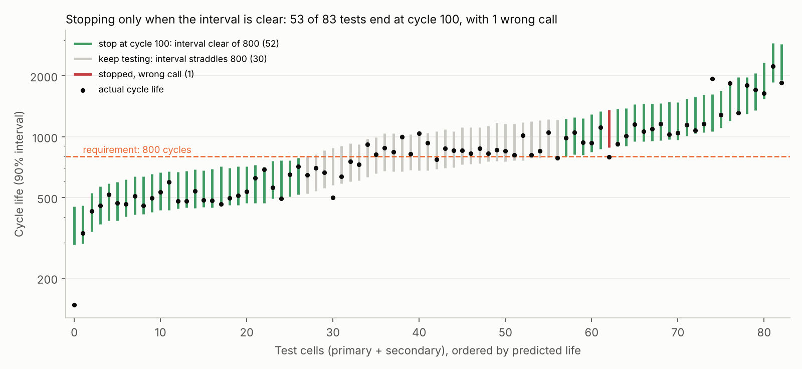
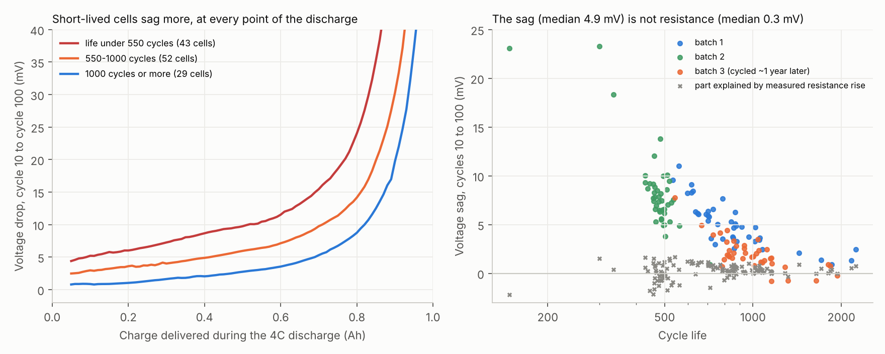
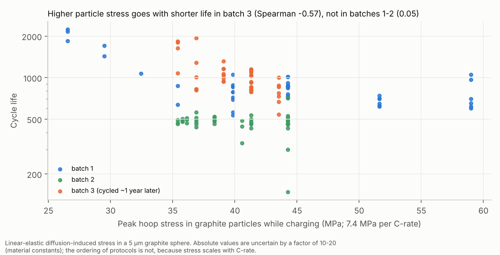

# Battery lifetime from the first 100 cycles, with intervals you can act on

**Result:** on 124 commercial lithium-ion cells, a model that sees only the first 100 charge–discharge cycles predicts each cell's lifetime with a **90% interval that holds its coverage on held-out cells** (39 of 43 inside on the primary test set, 35 of 40 on a batch cycled about a year later). Used as a screening rule ("does this cell last at least 800 cycles?"), the intervals let **53 of 83 test cells stop at cycle 100 with one wrong call**, saving **58% of the total test cycles**. Trusting the point prediction alone stops every test but makes **four wrong calls**. Physically, the early warning sign is a voltage sag of a few millivolts that internal resistance does not explain; and a stress model of the graphite particles links harsher charging protocols to shorter lives in the later batch.

Data: K. A. Severson, P. M. Attia, N. Jin et al., *Data-driven prediction of battery cycle life before capacity degradation*, Nature Energy 4, 383–391 (2019), [doi:10.1038/s41560-019-0356-8](https://doi.org/10.1038/s41560-019-0356-8); dataset from the Toyota Research Institute at [data.matr.io/1](https://data.matr.io/1/). The data are not redistributed here (see *Reproduce*). All modelling code in this repository is my own; the original study's licensed modelling code was not used.

## The problem

Testing a battery to the end of its life takes months: these cells lasted between 148 and 2,237 cycles. Severson et al. showed that the first 100 cycles already carry most of the information, predicting lifetime with roughly 10% error. A single predicted number is not enough to act on, though. To stop a test early, accept a cell design or reject one, an engineer needs to know how far to trust each prediction, and whether that trust survives when the next batch of cells is made and tested months later.

This project asks three questions:
1. Can the published early-prediction results be reproduced from the raw data?
2. Do prediction intervals hold their stated coverage on new cells, including a batch cycled about a year later?
3. Can the intervals decide when a lifetime test can safely stop at cycle 100?

## Data

124 A123 APR18650M1A cells (LFP/graphite, 1.1 Ah), each fast-charged under one of 72 protocols, discharged at 4C, and cycled at 30 °C until capacity fell to 80% of nominal. The standard cleaning and split from the original study were applied (`src/data.py`): 41 training cells, 43 primary-test cells, and 40 secondary-test cells from a third batch cycled about a year later.

Two cells have single-cycle logging glitches in their capacity record (1.54 Ah and 2.88 Ah on a 1.1 Ah cell). These values were replaced by the median of neighbouring cycles before computing features.

## Stage 1: reproducing the baseline

Features from cycles 1–100 follow the paper's definitions, chiefly the change in the discharge capacity–voltage curve between cycles 10 and 100, ΔQ(V). Models predict log₁₀(cycle life). Elastic-net penalties are chosen by cross-validation on the training cells only.

| Model | Train | Primary test | Primary (excl. outlier) | Secondary test |
|---|---|---|---|---|
| Variance (1 feature), this repo | 104 / 14.1% | 138 / 14.7% | 138 / 13.2% | 196 / 11.4% |
| Variance, paper | 103 / 14.1% | 138 / 14.7% | 138 / 13.2% | 196 / 11.4% |
| Discharge (6 features), this repo | 66 / 8.9% | 107 / 12.6% | 103 / 9.4% | 174 / 12.0% |
| Discharge, paper | 76 / 9.8% | 91 / 13.0% | 86 / 10.1% | 173 / 8.6% |
| Full (9 features), this repo | 60 / 7.1% | 119 / 11.6% | 117 / 9.0% | 230 / 12.7% |
| Full, paper | 51 / 5.6% | 118 / 14.1% | 100 / 7.5% | 214 / 10.7% |

Entries are RMSE in cycles / mean absolute percentage error. The one-feature model reproduces the paper exactly. The elastic-net models land within a few points; differences come from the hyperparameter search, and from the paper's full model leaving out four cells whose temperature probes failed. The intervals below are built on the **discharge model**, which generalised best in the original study.

## Stage 2: intervals that hold

Three ways of putting a 90% interval around each prediction, all fitted on the 41 training cells only:

- **Naive:** prediction ± 1.645 × the training residual SD. This is what a single error figure implicitly assumes.
- **Bayesian ridge:** a Gaussian predictive interval that includes uncertainty in the fitted coefficients.
- **Jackknife+:** a distribution-free interval built from 41 leave-one-out refits of the whole procedure, including the penalty search ([Barber et al., 2021](https://doi.org/10.1214/20-AOS1965)).



| 90% interval | Primary: coverage | Primary: median width | Secondary: coverage | Secondary: median width |
|---|---|---|---|---|
| Naive | 88.4% | 222 cycles | 82.5% | 392 cycles |
| Bayesian ridge | 90.7% | 229 cycles | 87.5% | 433 cycles |
| Jackknife+ | 90.7% | 255 cycles | 87.5% | 436 cycles |

The Bayesian and jackknife+ intervals hold their 90% target on the primary set. On the later batch, all three cover slightly fewer cells than promised, and the naive interval falls furthest. With 40 cells, each cell is 2.5 percentage points of coverage, so none of these shortfalls is statistically significant (binomial test, p > 0.1 throughout; `results/shift_secondary.csv`).

## Stage 3: the later batch

The secondary batch is where predictions get worse: the discharge model's error rises from 9.4% (primary, excluding the outlier) to 12.0%, and the median cell lives 7.7% shorter than predicted. In practice a lab would retrain once more cells finish. Retraining on the 84 finished training and primary cells cuts the secondary error from **12.0% to 9.0%**. It also brings jackknife+ coverage on the later batch from 87.5% to **90.0%**, with intervals of similar width (median 417 against 436 cycles).



## Stage 4: when can a test stop?

A screening question: does each cell last at least L\* cycles? Two rules, applied at cycle 100 to all 83 test cells, using intervals from the 41 training cells:

- **Interval rule:** stop the test only if the 90% jackknife+ interval lies wholly above or below L\*. Otherwise keep testing to the end of life, where the answer is exact.
- **Point rule:** stop every test and trust the point prediction.



| Requirement L\* | Interval rule: tests stopped at cycle 100 | Interval rule: wrong calls | Interval rule: test cycles saved | Point rule: wrong calls (all 83 stopped) |
|---|---|---|---|---|
| 600 cycles | 57 (69%) | 0 | 72% | 5 (6.0%) |
| 800 cycles | 53 (64%) | 1 | 58% | 4 (4.8%) |
| 1000 cycles | 48 (58%) | 0 | 48% | 8 (9.6%) |

The point rule saves more test time (88%) but gets 5–10% of cells wrong. The interval rule keeps testing exactly the cells whose fate is uncertain, the ones near the requirement, and stops the rest with almost no errors. Which trade-off is better depends on what a wrong call costs. The intervals make that choice explicit instead of hidden.

## Stage 5: what the early signal is, physically

Severson et al. attribute the early-life change in the discharge curve to loss of graphite active material and loss of lithium, based on separate low-rate diagnostic tests; they report no model of it. Here the 4C discharge curves at cycles 10 and 100 are compared at equal delivered charge, and the change is tested against three mechanisms (`src/physics.py`).



- **The early signal is mainly a voltage sag.** Between cycles 10 and 100, a cell's discharge voltage at the same delivered charge drops by a median of **4.9 mV**, growing towards the end of discharge. Short-lived cells sag more at every point of the curve.
- **It is not ohmic resistance.** The cells' internal resistance, measured independently, rose by only enough to explain a median **0.3 mV**, and that rise has no relationship with lifetime (Spearman ρ = 0.07). The sag itself tracks lifetime closely (ρ = −0.86), as does the small capacity loss fitted alongside it (ρ = −0.90). The cells' temperature during discharge changed by a median 0.12 °C, too little to explain the sag.
- **That points to the electrodes' reactions, as Severson et al. proposed, but the 4C data cannot pin down which.** A Butler–Volmer model of lost graphite surface area, whose extra overpotential grows as the graphite empties, fits the measured sag (median R² = 0.963), but no better than a uniform voltage shift plus capacity loss (0.959). The two cannot be told apart from fast-discharge curves; the low-rate diagnostic cycles the original authors used would be needed.
- **The later batch ages differently.** Batch 3 cells sag a median **1.7 mV**, against 6–7 mV in batches 1–2. This is the physical face of the batch shift seen in stages 2–3, and it is why these two physical quantities, though interpretable, predict lifetime worse than the statistical feature: 20.7% error on the primary set against 14.7%, and they fail on batch 3, whose values lie outside the training range.

## Stage 6: mechanics, the stress inside graphite particles during fast charging

When a cell charges, lithium enters the graphite particles through their surfaces and diffuses inward slowly, so the surface swells more than the core. Treated like a thermal-stress problem for an elastic sphere, a constant charging current settles within about 30 s into a parabolic lithium profile, and the hoop stress at the surface is

```latex
\sigma = \frac{E\,\Omega\,R^{2}\,n\,c_{\max}\,\Delta\theta}{45 \cdot 3600\,(1-\nu)\,D}
```

where n is the charge rate in C, E and ν the elastic constants, Ω the partial molar volume of lithium, R the particle radius, D the diffusivity, c_max the maximum lithium concentration and Δθ the lithium fraction swing (`src/mechanics.py`). With typical graphite values (E = 15 GPa, ν = 0.3, Ω = 3.65 × 10⁻⁶ m³/mol, R = 5 µm, D = 3.9 × 10⁻¹⁴ m²/s), that is **7.4 MPa per unit of C-rate**, so the 72 protocols put the particles under **27–59 MPa** at their fastest step. The material constants are uncertain by a factor of 10–20 either way, so the absolute stress is indicative; the ordering of protocols is not, because stress scales linearly with C-rate.



- In batch 3, protocols with higher peak stress gave shorter lives (Spearman ρ = −0.57, p = 0.0001). In batches 1–2 they did not (ρ = 0.05), but the charge-weighted average stress did (ρ = −0.40, p = 0.0002).
- Adding peak stress to the six-feature lifetime model changes little: primary-set error excluding the outlier goes from 9.4% to 8.6%, and the batch-3 error stays at 12.0%.
- Stress is not separable from the other effects of fast charging in this dataset. Heating and lithium plating also scale with C-rate, so these correlations show that harsher protocols age cells faster, not that particle cracking is the cause. Separating the mechanisms would need post-mortem imaging of the electrodes or cells charged at equal C-rate but different particle sizes.

## Limitations

- **One chemistry, one lab.** All cells are the same commercial LFP/graphite type, cycled at 30 °C under fast-charging protocols. Nothing here shows the intervals transfer to other chemistries, temperatures or usage.
- **Small test sets.** With 40–43 cells per set, coverage estimates are uncertain by roughly ±5 percentage points. The batch-shift effect on coverage is suggestive, not proven.
- **Jackknife+ guarantees rest on exchangeability.** The later batch breaks that assumption, which is exactly why it is tested separately here. Coverage held approximately, but there is no guarantee for future batches.
- **The decision rule is deliberately simple.** It stops at cycle 100 or tests to the end. A sequential rule that re-checks the interval as more cycles arrive would save more test time, and is the natural next step.
- **The one outlier cell** (148 cycles) falls far below its interval. It is still classified correctly at every threshold, but it shows that early-life features can miss an early failure mechanism.
- **The physical models are deliberately simple.** The voltage-sag model assumes a linear graphite lithium fraction over the discharge (0.80 to 0.02) and a single global kinetic constant; the stress model assumes uniform spherical particles and linear elasticity. They test which explanations fit the data, not the full electrochemistry. A physics-based cell model (for example PyBaMM's Doyle–Fuller–Newman model) fitted to low-rate diagnostic data is the natural next step.
- **Not a new dataset or model.** The contribution is the reproduction, the calibration check under batch shift, the decision analysis, and the physical and mechanical interpretation, all built on Severson et al.'s data and features.

## Reproduce

1. Download the three batch files from [data.matr.io/1](https://data.matr.io/1/) (project "Data-driven prediction of battery cycle life before capacity degradation") and run `python extract_first100.py` in the same folder. It writes a compact `battery_first100.npz`; place it in `data/`.
2. From the repository root:

```
pip install numpy scipy pandas scikit-learn matplotlib h5py
python src/baseline.py        # stage 1: reproduce the three published models
python src/intervals.py       # stage 2: interval coverage on both test sets
python src/shift_decision.py  # stages 3-4: retraining under batch shift, screening decision
python src/physics.py         # stage 5: voltage sag vs resistance, kinetic model
python src/mechanics.py       # stage 6: particle stress per charging protocol
python src/figures.py
python src/figures_physics.py
```

| File | Purpose |
|---|---|
| `extract_first100.py` | Turns the raw .mat files into a compact extract (cycles 1–100 plus per-cycle summaries) |
| `src/data.py` | Standard cleaning (124 cells) and train / primary / secondary split |
| `src/features.py` | Early-life features as defined by Severson et al. |
| `src/baseline.py` | Variance, discharge and full models; errors per split |
| `src/intervals.py` | Naive, Bayesian ridge and jackknife+ intervals; coverage |
| `src/shift_decision.py` | Retraining under batch shift; screening decision |
| `src/physics.py` | Voltage sag at equal charge; resistance check; Butler–Volmer area-loss model |
| `src/mechanics.py` | Diffusion-induced stress in graphite particles for each charging protocol |
| `src/figures.py`, `src/figures_physics.py` | Figures 1–3 and 4–5 |

## Author

Richard Olanite · Berm Engineering and Consulting Ltd · [github.com/thatboypage](https://github.com/thatboypage)
